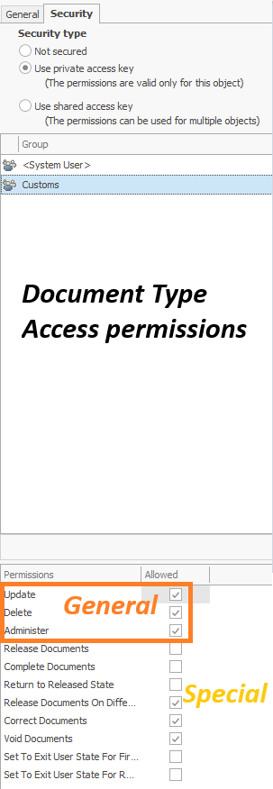

# Access permissions for documents

Access permissions determine which users can access protected resources in
ERP.net and which actions they can perform on them.

ERP.net uses **access keys** to protect resources, including entity types and
individual records. Permissions are assigned to **user groups**, and users
receive permissions through their group memberships.

Access to a resource and permission to perform an action are not the same.
For example, a user may be able to open a record without being allowed to
update or delete it.

## Access permissions on individual documents

An individual document can have its own access key. The permissions associated
with that key control access to the document and actions such as:

- **Update** 
- **Delete** 
- **Administer** 

For example, a group may have access to open a Sales order but not permission
to update it.

## How to secure individual documents 

Individual document permissions cannot be assigned directly through the
document's **Security** panel. Instead, an administrator configures security
conditions on the document type, and the system applies the appropriate access
key to matching new documents.

### Configuration

1. Create an [Access Key](https://docs.erp.net/model/entities/Systems.Security.AccessKeys.html)
   and assign the required permissions to the relevant user groups.

Group "Administrators" has permissions:
 

 

Group "Everybody" has no permissions but being listed here gives its members the ability to see and access the documents (not update them)
 

 

3. Open the document type in **DocumentTypesForm** and go to the
   [Document Types Form Security Conditions](https://docs.erp.net/model/entities/Systems.Documents.DocumentTypeSecurityConditions.html) panel.
4. Add a security condition with:
   - **Condition Filter XML** — determines which documents the condition applies to.
   - **Document access key** — the access key created earlier.
   - **Priority** — used to select a condition when more than one matches.
   - **Description** — identifies the condition.

 

 

For future documents of that type that match the condition, the system applies the selected key. 

The individual document's security type is set to **Shared access key**.

 

 

### Example

To allow the **Administrators** group to edit "Direct Sale" orders while preventing the
**Everybody** group from editing them:

1. Create an access key that gives both groups permission to open documents,
   but gives **Update** permission only to the Administrators group.
2. Add a security condition to the "Direct Sale" document type, selecting
   that access key and setting the appropriate filter.
3. Check all of each user's group memberships to establish their effective
   permissions.

A new "Direct Sale" order that matches the condition receives the shared access key
from the system. A user who can open the document but has no effective **Update** permission under that key cannot edit it.

> [!NOTE]
> The condition applies to future matching documents. Verify separately how to secure documents that already exist. 
> When checking a user's permissions, consider **all groups** the user belongs to. A permission granted through one group is not removed simply because it is
unchecked for another group.

Read the domain model [HERE](https://docs.erp.net/model/entities/General.Documents.Documents.html#accesskey)

## Permissions and document states

A document's **state** and a user's **permissions** are separate considerations:

- The state determines which changes and transitions are generally allowed.
- Permissions determine whether the user is allowed to perform an action.

For example, a document in the **New** state can generally be edited, but
the user must also have the applicable permissions. Conversely, having update
permission does not override restrictions imposed by the document's state.

See also

- [Security in ERP.net](https://info.erp.net/information/system-information/security.html)
- [Document states](https://docs.erp.net/tech/concepts/documents/states.html)

## Document type access permissions

A document type also has its own access permissions. Some apply to the
**type definition**, while others control specific actions on **documents of
that type**.

The **Access Permissions** panel for a document type contains two kinds of permissions:

| Type | Permission | What it controls |
| --- | --- | --- |
| General | **Update, Delete, Administer** | Changes to the document type definition and its security. |
| Special | **Release Documents, Complete Documents, Void Documents**, and other named document actions | The corresponding actions on documents of that type. |

See the [Document Types reference](https://docs.erp.net/model/entities/Systems.Documents.DocumentTypes.html).

### Example: Editing but not releasing

A user has no Update, Delete, Administer or Release Documents permission on the document type "Direct Sale".

- He cannot edit the **document type definition**.
- He may still be able to edit and save an order of that type in a state lower than "Released"
- He cannot release the order unless he receives "Release Documents" permission 

A document's state and its permissions are separate checks: **New** generally allows editing, but it does not override access restrictions. See [Document States](https://docs.erp.net/tech/concepts/documents/states.html).

## Check all group memberships

If a user belongs to multiple groups, check all of them: a permission may be granted through another group.

See [Security](https://info.erp.net/information/system-information/security.html).
