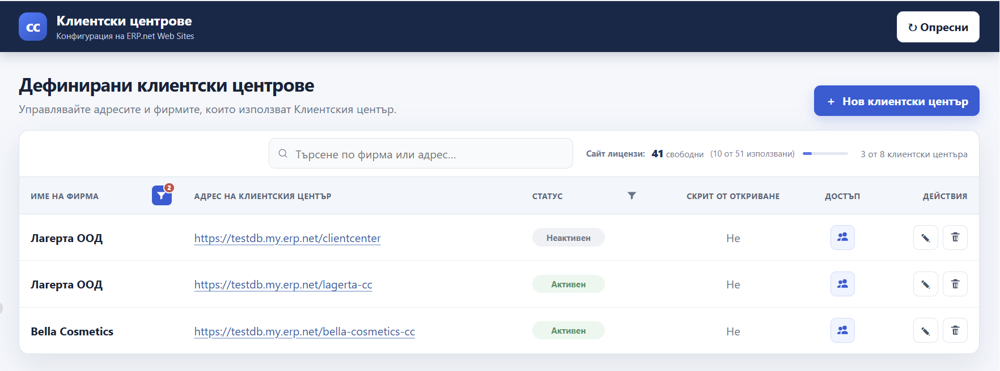
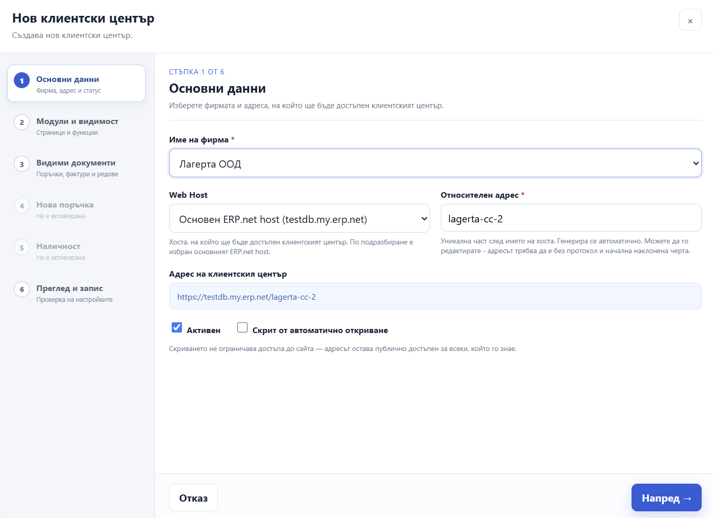
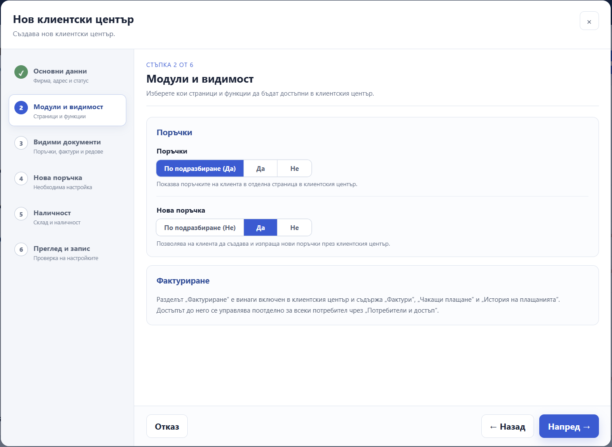
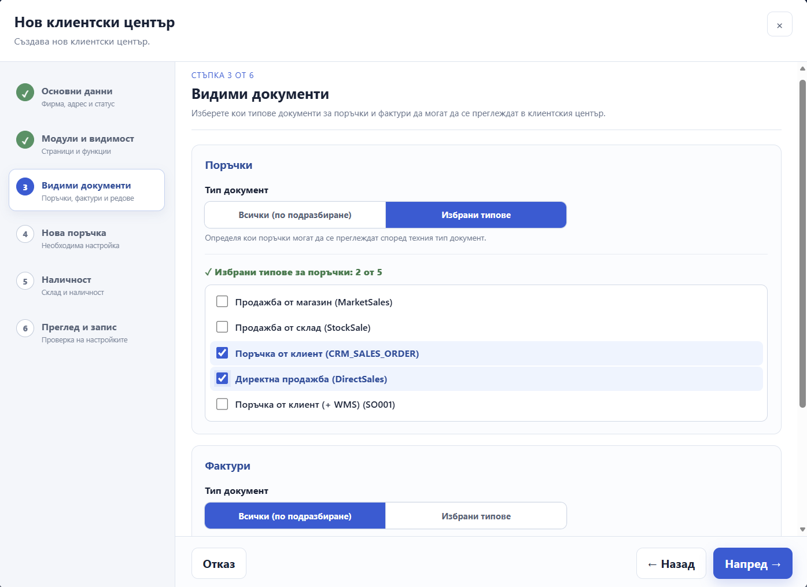
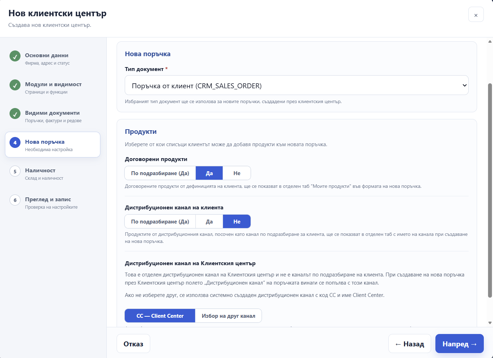
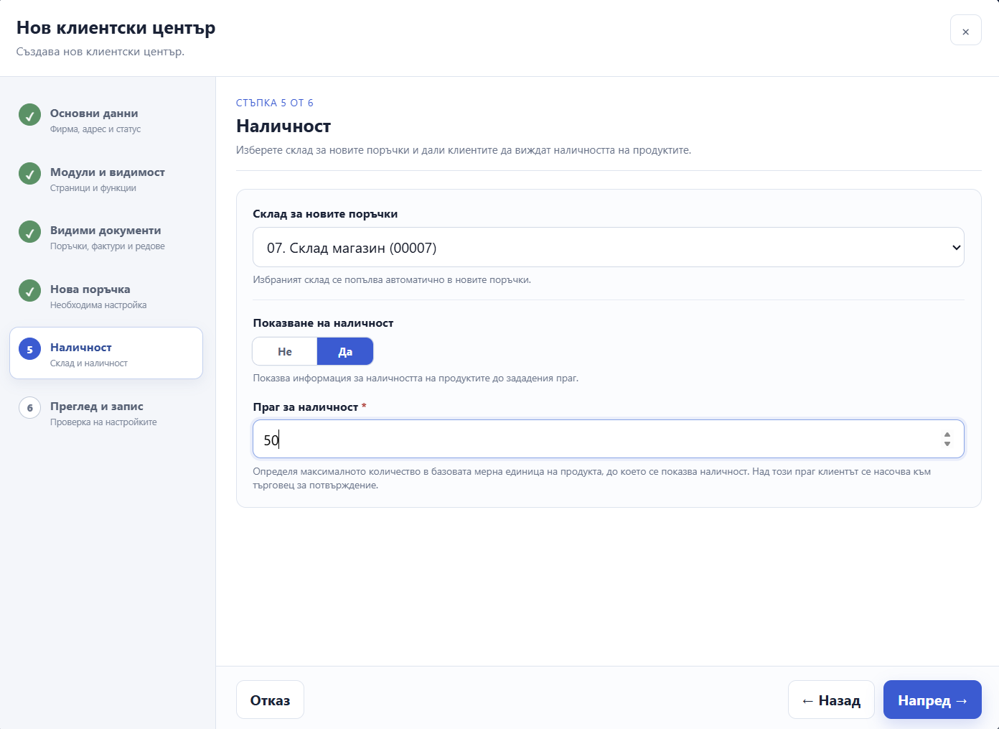
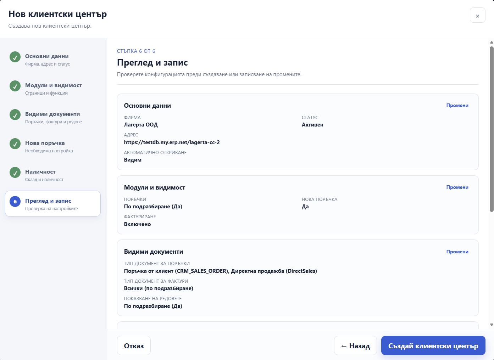
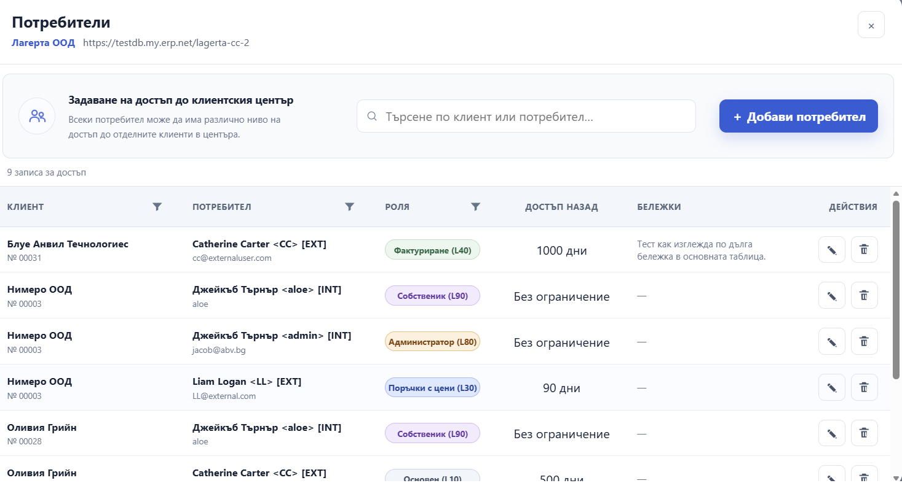
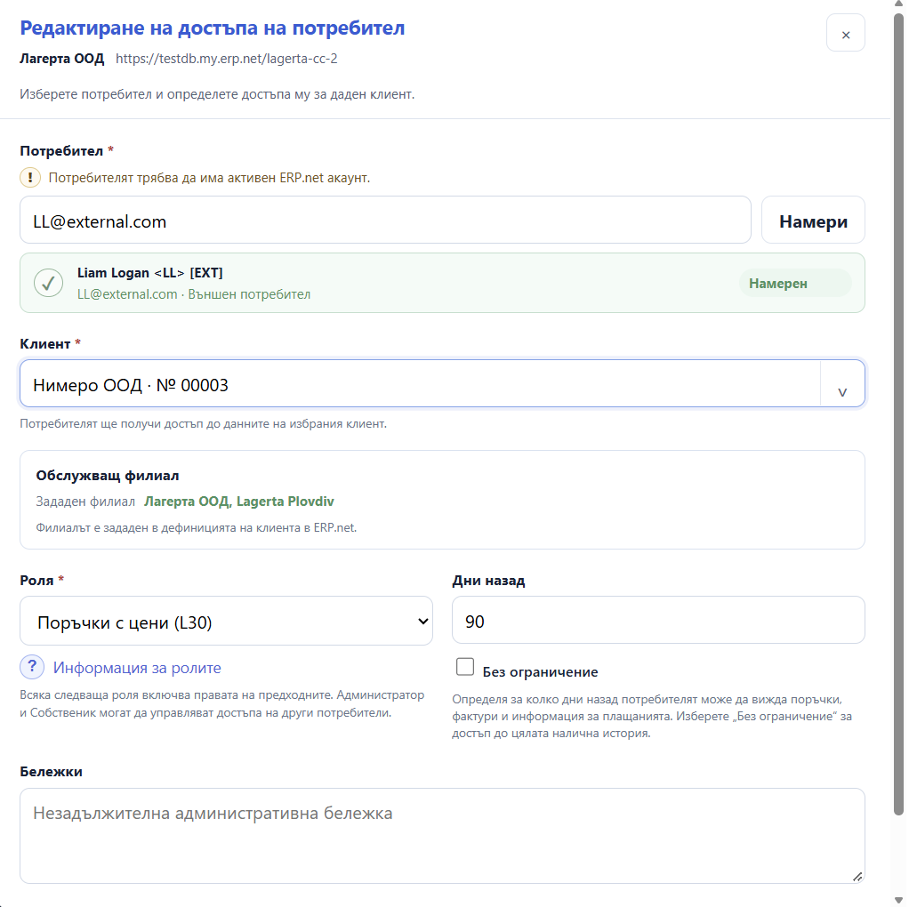
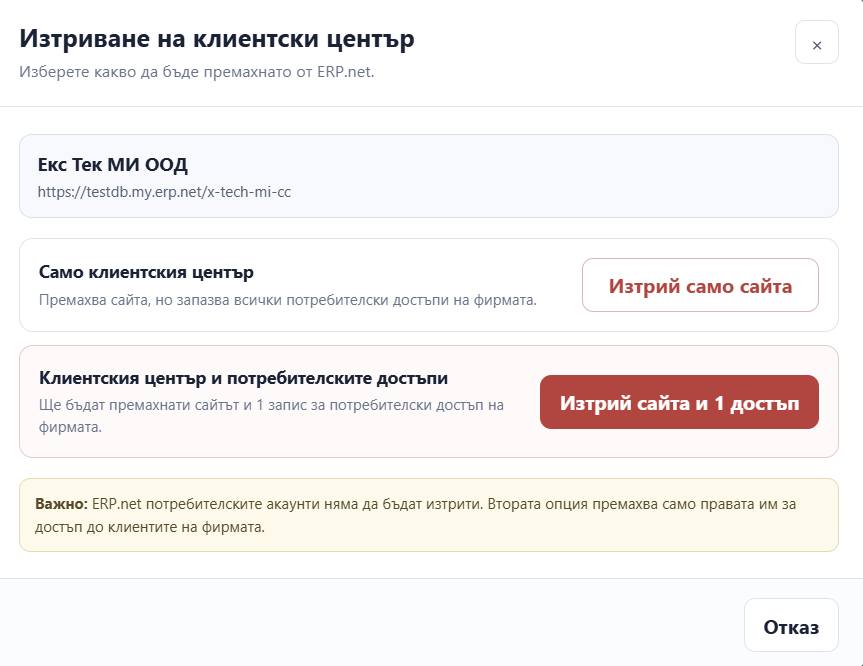

# Configuring a Client Center with the Setup App

## Purpose

The Client Center Setup App is used to view, create, edit, and delete ERP.net websites of type Client Center. It also allows you to manage users’ access to the Client Center for individual customers.

A Client Center gives customers access to information and documents such as orders, invoices, and payments. Depending on their settings and role, users may also be able to create new orders.

> **Note:** The app interface is currently available in Bulgarian only. Screenshots in this guide reflect the original interface language.

## Before you start

To configure a Client Center, you need to know:

- Which Enterprise Company the Client Center is for.
- Which Web Host to use and the desired website address.
- Which document types should be visible to customers.
- Whether customers should be able to create new orders and, if so, which document type, products, and warehouse settings to use.
- An existing ERP.net user account for each person who will be granted access.

The app displays the available license information and may prevent you from creating a new Client Center if no license is available.

## Viewing Client Centers

The main screen lists the defined Client Center websites. You can search by company name or address, filter by company and status, and refresh the list.

For each website, the list shows the company, address, status, whether the website is hidden from automatic discovery, access information, and available actions. Select the address to open the website in a new tab. Use the actions in the row to edit the website, manage user access, or delete it.

> **Important:** “Hidden from automatic discovery” is not a security setting. The website remains accessible to anyone who knows its address.

## Creating a Client Center

Select **New Client Center**. The form is organised into six steps. Some settings depend on other features being enabled, so follow the guidance shown in the form.

### 1. Basic information

1. Select the **Enterprise Company**.
2. Select the **Web Host**. The primary ERP.net host is selected by default.
3. Enter the **Relative URL** (relative address)—a unique part of the website address, without the protocol or a leading slash. Do not use spaces. The combination of Web Host and relative address must be unique.
4. Check the generated address.
5. Choose whether the website should be **Active** and whether it should be **Hidden from Automatic Discovery**.

### 2. Modules and visibility

Choose whether to display the **Orders** page and whether users can create a **New Order**. For each setting, you can keep the system default or explicitly select Yes or No.

The **Invoicing** section is included in the Client Center. Each user’s access to invoices, payments, and payment history is determined by their role.

### 3. Visible documents

Configure which document types users can view:

- For **Orders**, select all types or only selected types.
- For **Invoices**, select all types or only selected types.
- For **Document Lines**, choose whether to show order and invoice lines (the `HideLines` setting).

If you select **Selected Types**, select at least one document type. When the Orders setting is disabled, options for order document types may not be available.

### 4. New order

Use this step when creating new orders is enabled. Select the required **Document Type** for new orders.

You can also control which product lists are available:

- **Customer Products**, displayed in the **My Products** tab.
- Products from the customer’s **Default Distribution Channel** (`DefaultDistributionChannel`).
- Products from the Client Center **Site Channel** (`SiteChannel`).

By default, the Client Center uses a site channel with code **CC** and name **Client Center**. Products linked to the site channel appear in a separate tab in New Order when available. Orders created through the Client Center are associated with the site channel.

### 5. Availability

You can select a **Default Store** (`DefaultStore`) for new orders. If no store is selected, new orders are created without a store, which can be specified later when the orders are processed in ERP.net.

To enable **Show Availability**, select a default store and enter a positive whole number for **AvailabilityMax** (the maximum availability threshold). This setting limits the quantity for which availability can be displayed directly. For requested quantities above this threshold, the Availability column shows **Call**, indicating that the customer should contact a sales representative for confirmation.

### 6. Review and save

Review the configuration summary before saving. If there is a problem with a setting or a selected value, the app marks the relevant step or field and displays a warning.

The **Advanced Settings — SettingsJson Preview** section is read-only. Configure settings using the fields in the app. Changes to this section must be made separately in ERP.net.

Select **Save** to create the website. Once it has been created, you can grant users access immediately or do so later using **Users and Access** in the list.

### Changes that require a restart

Changing Client Center settings may require restarting the website through **Instance Manager**. If the app displays a restart message, use the suggested action or open Instance Manager. Administrator permissions may be required to restart the website.

## Editing a Client Center

Select the edit action in the website’s row. Review and change the necessary steps, then check the configuration in **Review and Save** and save your changes.

If a website row displays a settings warning, open it for editing and check the highlighted fields. If `SettingsJson` is invalid, the app displays a separate warning. Do not edit the advanced field directly in the app—it is read-only.

## Managing users and access

Select **Users and Access** for the relevant Client Center. You can search by customer or user, filter the list, and grant, change, or remove access to the Client Center for individual customers.

### Adding or editing access

1. Select **Add User**, or choose the edit action for an existing record.
2. Enter the exact email address or username and select **Find**.
3. Confirm that the correct active ERP.net user has been found.
4. Select the customer.
5. If **Serviced by Enterprise Company Location** is not defined for the customer, select an available enterprise company location if the app requires one.
6. Select a role and configure the access period.
7. Optionally, add an administrative note.
8. Select **Save Access**.

The user must already have an active ERP.net account. The app searches for the exact email address or username entered; it does not create the user account. A user cannot be granted access more than once for the same customer.

> **Serviced by Enterprise Company Location:** If you select a location for a customer who does not yet have one defined, the app also saves the selected location in the customer’s ERP.net record—not just in the Client Center access settings.

### Roles

Each successive role includes the permissions of the roles before it:

| Role | Main permissions |
|---|---|
| **L10 - Basic** | Home page and customer profile; no orders or invoicing. |
| **L20 - Orders** | View and create orders without prices, discounts, or totals. |
| **L30 - Orders + Prices** | Orders with prices, discounts, and totals. |
| **L40 - Billing** | Adds access to invoices, due payments, and payment history. |
| **L80 - Admin** | Manage other users’ access and access all available customer data. |
| **L90 - Owner** | Admin permissions; Owner access cannot be revoked by anyone, including Admins. |

Select **Role Information** in the form to see more details about each level.

### Days Back Access

Enter a non-negative whole number in **Days Back Access** to limit how far back the user can view historical records. Select **No Limit** to provide unrestricted access to available history.

### Removing a user’s access

Removing access prevents the user from accessing the Client Center for the selected customer. It **does not delete the ERP.net user account**. Before confirming, check the specified user and customer carefully.

## Deleting a Client Center

When deleting a website, select one of the available options:

- **Delete the Website Only**—deletes the Client Center website but keeps the existing user access settings for customers.
- **Delete the Website and Access Records**—deletes the website and its associated user access settings for customers. ERP.net user accounts are not deleted.

The second option may be unavailable if those user access settings are also used by another Client Center for the company, or if the app cannot safely determine which settings should be deleted.

## Troubleshooting

### The user cannot be found

Check that you entered the exact email address or username and that the user already has an active ERP.net account.

### The user already has access to the Client Center for this customer

Edit the user’s existing access instead of adding it again.

### Availability cannot be enabled

Select a default store and enter a positive whole number for **AvailabilityMax**.

### A settings or value warning is displayed

Open the editor and check the highlighted steps and fields. If a setting refers to a missing or unavailable document type, distribution channel, or store, select a valid value for the relevant company.

### Changes are not visible on the website

Check whether the app requested a restart. If necessary, restart the Client Center through Instance Manager.

## Related documentation

- [Client Center — Overview](https://docs.erp.net/tech/modules/crm/clientcenter/index.html)
- [How to set up a Client Center](https://docs.erp.net/tech/modules/crm/clientcenter/how-to/define-a-new-cc.html)
- [Settings and errors](https://docs.erp.net/tech/modules/crm/clientcenter/reference.html)
- [How to add new users and manage permissions](https://docs.erp.net/tech/modules/crm/clientcenter/how-to/setup-a-new-user-account-v26.html)
- [User Management](https://docs.erp.net/tech/modules/crm/clientcenter/user-management/index.html)
