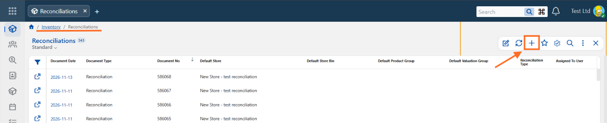
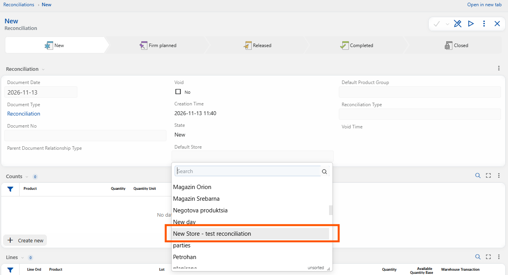
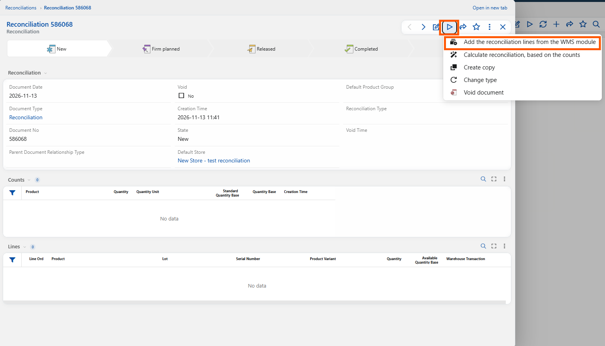
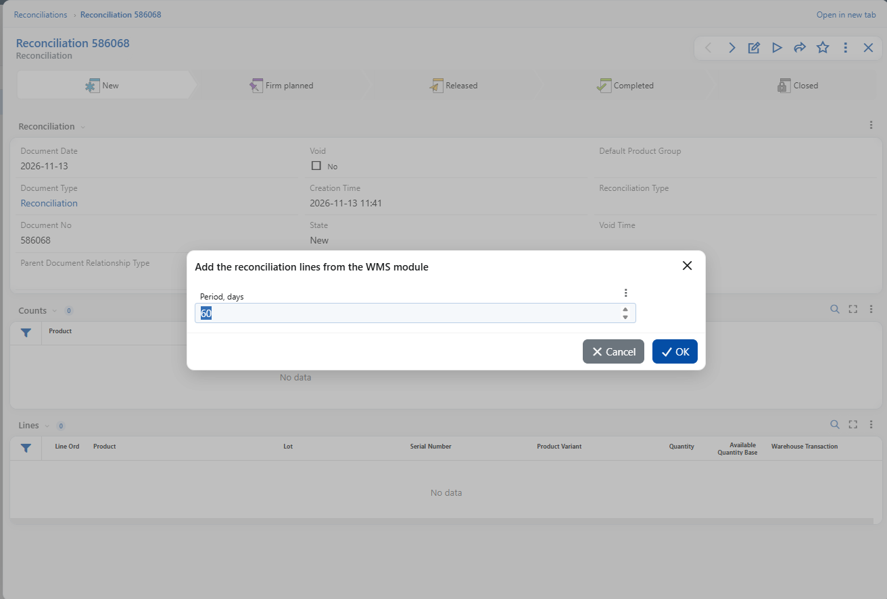
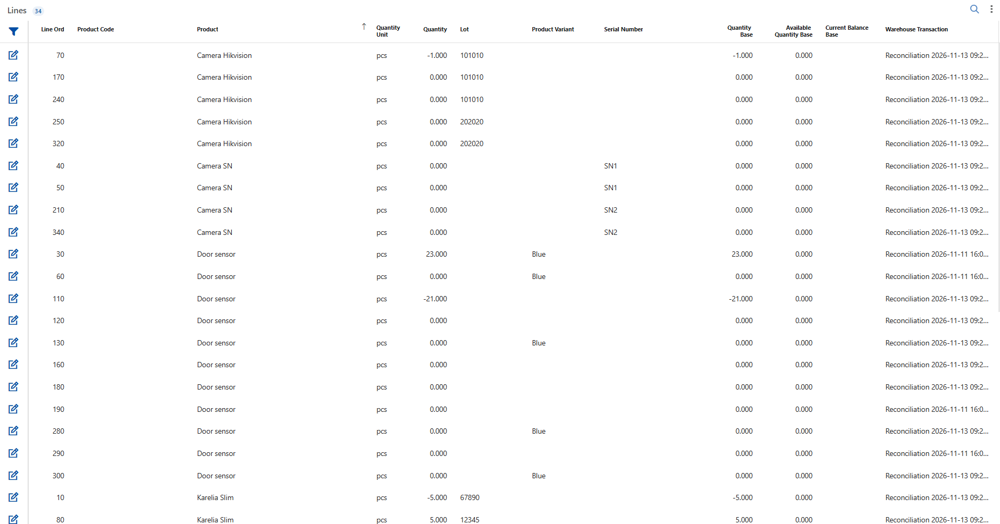

# Transfer the result to Inventory Reconciliation

Use this operation to transfer approved warehouse reconciliation differences from WMS to an Inventory Reconciliation document.

The operation loads eligible Warehouse Transactions and creates Inventory Reconciliation lines. The lines can then be reviewed and applied to Inventory by releasing the Inventory Reconciliation.

## When to use it

Use this operation after:

- counting and review are complete;
- the relevant Warehouse Reconciliation details are approved;
- the Warehouse Reconciliation is released;
- the corresponding adjustment Warehouse Transactions are generated.

Releasing the Warehouse Reconciliation applies the approved differences to WMS availability. Transferring and applying the result to Inventory is a separate stage.

For the preceding operation, see [Generate warehouse transactions](https://docs.erp.net/tech/modules/logistics/wms/planned-reconcile/operations/generate-warehouse-transactions.html).

## What the operation uses as input

The operation uses:

- the current Inventory Reconciliation document;
- its **Default Store**;
- the **Period, days** parameter;
- eligible Warehouse Transactions for the selected store and period.

Default Store is required. If it is not specified, the function returns an error.

The operation loads eligible transactions with `TaskType = Reconciliation`. Transactions associated with counting use `TaskType = Count` and are not the source of this import.

The selected period can include eligible transactions from more than one warehouse reconciliation.

## How to run the operation

1. Open **Logistics > Inventory > Reconciliations**.

2. Create an Inventory Reconciliation.

   

3. Select the required **Default Store** and save the document.

   

4. Open **UI Functions** and select **Add the reconciliation lines from the WMS module**.

   

5. Enter the required value in **Period, days** and confirm.

   

6. Review the generated lines, quantities, and Warehouse Transaction references.

7. When the result is accepted, release the Inventory Reconciliation.

## What the operation creates

The function creates one Inventory Reconciliation line for each eligible Warehouse Transaction and retains a reference to that transaction.

When several eligible transactions represent the same inventory identity, the function offsets their quantities. One source-linked line carries the signed totals for the group; the other source-linked lines in that group have zero quantities.

## How transactions are grouped

The function groups eligible transactions by:

- Product;
- ProductVariant;
- Lot;
- SerialNumber.

All four values must match, including empty values.

Warehouse location does not split a group. Transactions from different warehouse locations can therefore be offset when their product, variant, lot, and serial number match.

Other transaction characteristics, such as logistic unit, warehouse order, direction, and creation time, also do not split a group. Direction is used to calculate the signed result.

## How quantities are offset

For each group, the function calculates signed totals separately for:

- `Quantity`;
- `QuantityBase`;
- `StandardQuantity`.

The totals are placed on one of the source-linked lines. The corresponding quantities on the other lines in the group are set to zero.

### Example: matching transactions

Three eligible transactions have the same product, variant, lot, and serial number. Their signed quantities are:

- `+10`;
- `-3`;
- `+2`.

The resulting total is `+9`.

The function creates three linked reconciliation lines. One line carries `+9`; the other two carry `0`. Each line retains its own Warehouse Transaction reference.

### Groups with a zero result

If all calculated group totals are zero, the source-linked lines remain in the Inventory Reconciliation with zero quantities.

**Do not delete** these lines solely because their quantities are zero: the links retain the connection to the source transactions.

### Different totals for different quantity fields

A zero `Quantity` total does not necessarily mean that `QuantityBase` is also zero. The function calculates each quantity field separately.

For example:

| Transaction | Quantity | QuantityBase | StandardQuantity |
|---|---:|---:|---:|
| IN | 2 br | 1 kg | 4 kg |
| OUT | 2 br | 2 kg | 4 kg |

After applying the direction signs, the group totals are `0 br`, `-1 kg`, and `0 kg`, respectively. One linked line carries these totals; the other carries zeros.

## How the function identifies processed transactions

A Warehouse Transaction is considered processed when a line referencing it exists in a **released, non-voided Inventory Reconciliation**. The function excludes such transactions from subsequent imports.

This rule also applies to lines with zero quantities. Their references show that the source transactions have been included in a released reconciliation, regardless of the total for the group.

**Creating lines in an unreleased document does not mark their source transactions as processed.** A link to a voided reconciliation does not qualify either. These transactions can still be selected if they meet the other eligibility conditions.

## Running the function again

You can run the function again to refresh the generated result in the same Inventory Reconciliation.

**Important:** Running the function again deletes and recreates the previously generated lines with recalculated quantities. Review the new lines before releasing the reconciliation.

Review the newly generated lines again before releasing the document.

## Review and apply the result

Check the generated quantities and their Warehouse Transaction references. Keep source-linked lines whose quantities are zero: these references are required to recognize the corresponding transactions as processed after release.

When the result is correct, **release the Inventory Reconciliation** to apply the differences to Inventory. The linked Warehouse Transactions will then be excluded from subsequent imports, provided the reconciliation remains released and non-voided.

## Related topics

- [Planned Reconcile](https://docs.erp.net/tech/modules/logistics/wms/planned-reconcile/index.html)
- [Warehouse reconciliation scenarios](https://docs.erp.net/tech/modules/logistics/wms/planned-reconcile/warehouse-reconciliation-scenarios.html)
- [Generate warehouse transactions](https://docs.erp.net/tech/modules/logistics/wms/planned-reconcile/operations/generate-warehouse-transactions.html)
