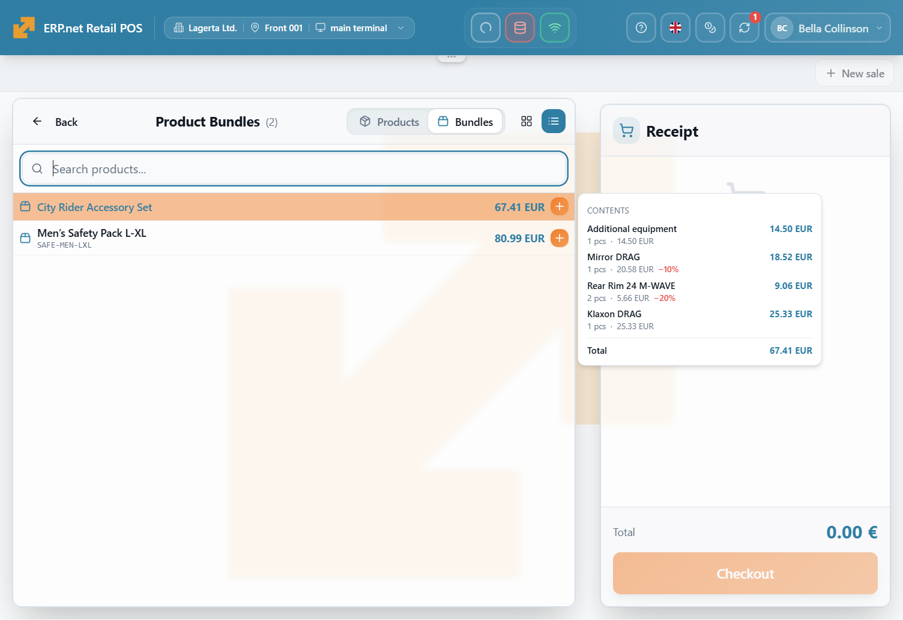
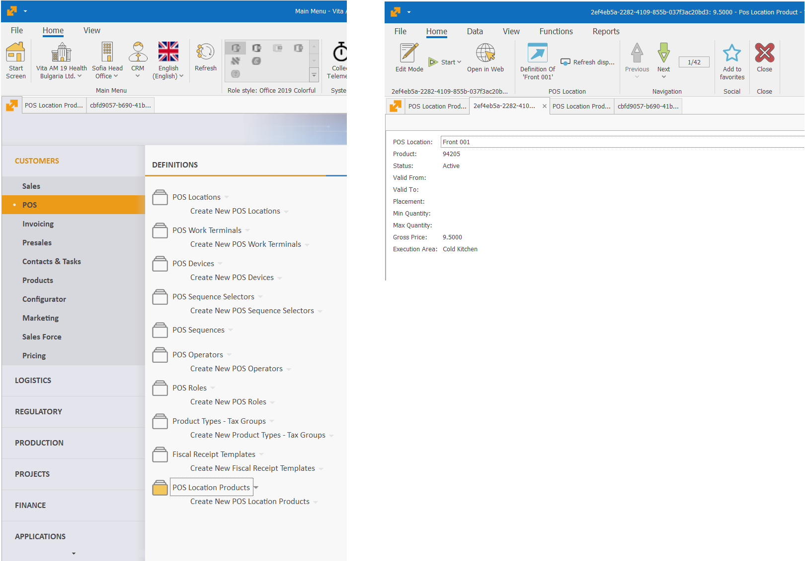

# POS

## Notable Features

## Other Features

**1. POS Product Bundles**

You can now create and manage product bundles for use in your point-of-sale locations. A bundle combines several products into one ready-to-sell offer, helping staff serve customers faster and ensuring consistent promotions across your business.

With Bundles, you can define the bundle’s name, code, availability period, and where it can be used—such as selected POS locations, groups, or terminals. With Bundle Lines, you specify the individual products included in the offer, their quantities, units of measure, and any applicable line-level discounts.

Bundles can be used for meal deals, gift sets, promotional packages, seasonal offers, starter kits, and other multi-item sales. They make it easier to present attractive offers to customers while keeping product combinations and discounts centrally controlled.

**2. POS Location Products in Desktop client**

The entity is now also available in the Desktop Client, as part of our ongoing efforts to provide a consistent experience across the Desktop and Web Clients.

Learn more [HERE](https://docs.erp.net/tech/modules/crm/pos/pos-location-products.html)

