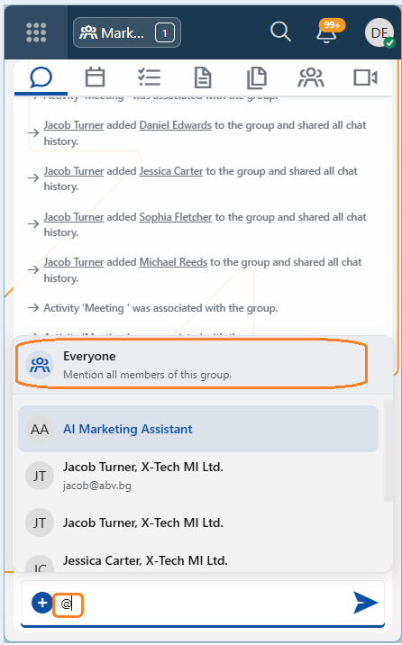

# Social interactions 

**Version 27**

The Social Interactions framework in ERP.net brings team collaboration to life through three core components — Social Groups, the Discussions/Chat panel, and Notifications.

## 1. Mention everyone in a group chat

Get everyone’s attention with a single mention! Type **@** in a social group chat and select **everyone** (or **всички**) to notify all group members at once.

Each member receives a standard mention notification, respecting their notification settings. The sender is excluded.

This feature is available **only in social group chats**, not in discussions attached to records.   

