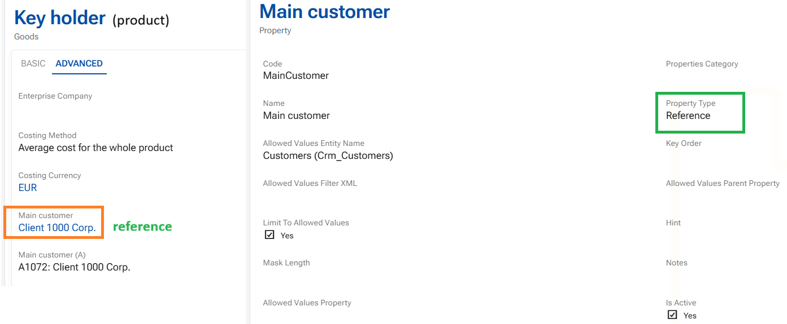

# System features

This section introduces **new and improved ERP.net system capabilities** that are not limited to a particular client or business module. These features extend how the platform stores, connects, validates, and makes data available. Where relevant, each update also explains how you can use it in the Desktop and Web clients.

## 1. Stored Attributes of Type Reference

Stored attributes now support a new **Reference** type. It lets you link a record to a specific record elsewhere in ERP.net—for example, to select a **Main customer** for a product.

To create one, add a stored attribute, set its **Property Type** to **Reference**, and select the target repository in **Allowed Values Entity Type**. You can then select a value for the attribute in both the Desktop and Web clients.

**How is this different from a Text attribute with entity-backed allowed values?** 

A Text attribute can also offer records from another repository as choices and may store the selected record’s ID. Those records, however, serve as the *source of allowed values*. With a Reference attribute, the selected record is treated as the *object the attribute refers to*. The record ID identifies the reference; its stored text is only a display representation, not the authoritative value. This reference visualized as a link, really links and leads to the exact record which can be opened and observed in WEB Client.

System Business rules help preserve the integrity of Reference attributes by validating their configuration and values. This makes references more reliable than depending on a displayed name, while giving users a familiar way to select linked records.

In the Web client, a Reference attribute can be selected from the entity’s **system items** when customizing a form—not only from the **Stored Attributes** section. The corresponding stored-attribute field, bears the suffix **“(A)”**, may also appear there - it is the text value of the reference. To change the selection, use the reference field.

Learn more from the dedicated page: [User-defined references](https://docs.erp.net/dev/domain-api/common-tasks/custom-property-references.html)

## 2. Master Document Activation and Deactivation Dates for Document Routes

Document routes now support two new optional fields: **Master Document Activation Date** and **Master Document Deactivation Date**.

When a document generates the next document through a route, the system can now check not only the date of the document performing the generation, but also the date of the original document that started the document flow.

For example, a **Warehouse Order** generated in November may belong to a document flow that started from a **Sales Order** dated in October. When the Warehouse Order generates the next document, the existing **Activation Date / Deactivation Date** fields check the Warehouse Order date, while the new master document dates check the date of the original Sales Order.

This makes it possible to introduce new routes for document flows started from a specific date, while unfinished older flows can continue using their previous routes.

The new fields are configured directly on the document route and work together with the existing activation dates and all other route conditions.

For configuration details, examples, and important considerations when changing existing routes, see [Route activation dates](../../../advanced/document-flow/route-activation-dates.md).

## 3. System-Calculated Attributes: Total Line Amount and Amount To Pay 

The **Total Line Amount** and **Amount To Pay** system-calculated attributes are being extended to **Invoice Orders, Receiving Orders, Purchase Invoices, and Offers (Total Line Amount only)**.

These attributes give users a convenient way to view key document amounts without manual calculations. 

👉**Total Line Amount** represents the sum of the document’s lines. For Offers, it includes **all lines**, including unselected alternatives.

👉**Amount to Pay** is the total amount payable for a document calculation - Total Line Amount + additional amounts marked “Add To Customer”. 
Those additional amounts can include VAT and other charges payable by the customer.

👉 **Both** calculated attributes can be displayed in the document header and in navigators, making key amounts easy to review. However, they cannot be used as search criteria in the advanced filter.

This enhancement makes financial figures easier to review when working with documents.
 

 
