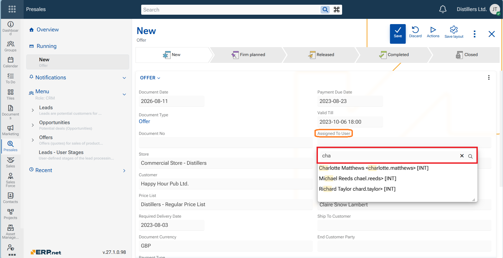

# WEB Client 

The @@webclientfull is the web-based user interface of the ERP.net business-management platform. It is one of the primary ways to access and interact with all the modules inside the ERP.net system—such as CRM, financials, inventory, production and more.

## Notable features

### ⭐ A new way to set Default values

We have added a new table and entity, [Entity Attribute Default Values](https://docs.erp.net/model/entities/Systems.Core.EntityAttributeDefaultValues.html), for storing default values for fields. This is now the **preferred approach** for creating default values. Values configured through the new approach can be applied in both the **Desktop Client** and the **Web Client**.

 

➡️**Who can configure defaults?**

The **Set** and **Manage** options are available to users with **Global Layout Manager permissions and the Layout Admin role**. Other users do not see these options.

➡️**Set a value for the right context**

As in the Desktop Client, saving a default value in the Web Client lets you choose the conditions under which it applies.

Open a field’s context menu and select **Default attribute value → Set as default attribute value**.

 

The dialog shows the value you are saving and lets you select any applicable conditions:

- current user
- current role
- enterprise company
- company location
- language
- entity category

 

You can also select "For all cases". In that case, the saved value is applied immediately when a new record is created. 

**OK** button creates a record in the new table that will be applied in the new objects.

 

When conditions are selected, the default applies in a matching context. If more than one saved default is applicable, the value matching the **most conditions** is used.

Default attribute values are *context-sensitive*. If the relevant context changes—for example, the user switches role, enterprise company, company location, language, or record category—the applicable defaults are evaluated for the new context.

➡️ **Review and manage saved values**

Use option "Manage default attribute value" to open the navigator and review or edit saved settings.

The existing "Default Values" records and the new "Entity Attribute Default Values" records are separate but they work in both the Desktop Client and the Web Client. **Before creating or changing a default, check both sets of records for settings that could apply to the same field in the same context.** This is recommended to avoid conflicting defaults.

> [!IMPORTANT]
> Administrators should carefully review saved settings — records in both the existing DataEntryDefaultValues table and the new EntityAttributeDefaultValues table — and avoid configurations that could apply to the same field in the same context. Although tests of the feature show that Desktop client "prefers" values from the old table, administrators need not rely on the order in which matching values are found to select a particular default.

Learn how to use the new entity from [HERE](https://docs.erp.net/webclient/introduction/how-to/create-default-value.html)

## Other features

### 1. Search box for all list fields

Finding values in dropdown lists is now easier. Whenever you open a dropdown list using the **chevron**, a search box is now immediately available and ready for typing. Whether you need to find a Customer, a Responsible person, or a Product, just insert some key symbols into the Search box and the results will be filtered. This improvement is available consistently throughout the Web Client, helping you find and select values faster—regardless of the list size.

